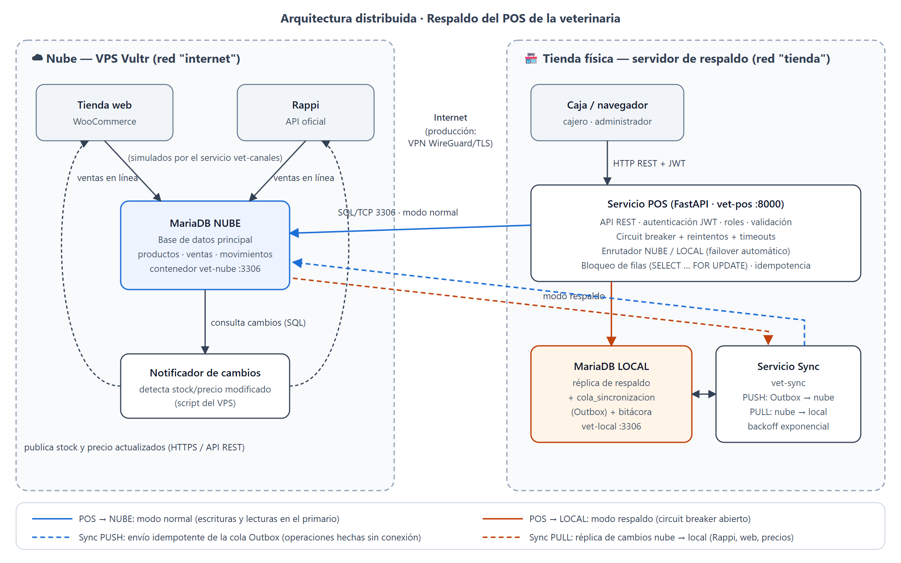

# Servidor de respaldo distribuido para el POS de una veterinaria

Proyecto de la asignatura **Sistemas Distribuidos**, Universidad Manuela Beltrán.

El inventario y los precios de la veterinaria viven en una base de datos MariaDB alojada en un VPS (Vultr). Esa base alimenta tres canales: la tienda física (POS), la tienda web (WooCommerce) y Rappi. Si el VPS se cae o la tienda pierde internet, el punto de venta se detiene.

Este proyecto agrega un **servidor de respaldo físico en la tienda**. El POS cambia a ese servidor de forma automática, sigue vendiendo y, cuando vuelve la conexión, **sincroniza todo con la nube sin duplicar ventas**.

> ⚠️ **Simulación.** Por seguridad, este repositorio **no** contiene credenciales, direcciones ni datos reales. La infraestructura se reproduce con contenedores Docker y los productos son ficticios. El POS comercial se representa con un servicio propio que implementa las mismas operaciones (vender, cambiar precios, consultar inventario).



## Componentes

| Contenedor | Rol | Tecnología |
|---|---|---|
| `vet-nube` | Base de datos principal (simula el VPS de Vultr) | MariaDB 11.4 |
| `vet-local` | Servidor de respaldo físico de la tienda | MariaDB 11.4 |
| `vet-pos` | API REST y panel del punto de venta, con failover | Python 3.12, FastAPI |
| `vet-sync` | Sincronización bidireccional (Outbox → nube, réplica nube → local) | Python 3.12 |
| `vet-canales` | Simula las ventas de WooCommerce y Rappi y el script notificador del VPS | Python 3.12 |

## Conceptos de sistemas distribuidos aplicados

- **Tolerancia a fallos:** timeouts, reintentos con *backoff* exponencial, *circuit breaker* (CERRADO → ABIERTO → SEMIABIERTO) y *failover* automático al nodo local.
- **Replicación:** copia nube → local cada 2 s, más el patrón **Outbox** (cola local → nube) para las operaciones hechas sin conexión.
- **Consistencia eventual** con resolución de conflictos: el POS es la autoridad. Sus ventas se aplican como deltas de stock y sus precios prevalecen. Una sobreventa queda registrada como conflicto.
- **Idempotencia:** cada venta tiene un UUID y los movimientos usan `INSERT IGNORE`, así que un reintento nunca duplica una venta.
- **Concurrencia:** transacciones con `SELECT … FOR UPDATE` y orden fijo de bloqueo. Con 50 ventas simultáneas sobre 20 unidades se venden exactamente 20.
- **Seguridad:** autenticación JWT, autorización por roles (admin/cajero), validación de entradas con Pydantic, consultas parametrizadas, secretos en `.env`, contenedores sin root y bases de datos expuestas solo en `127.0.0.1`.

## Inicio rápido

```bash
cp .env.example .env            # y cambie las claves
docker compose up -d --build
# abra http://localhost:8000
```

Para simular fallas:

```bash
python scripts/simular.py cortar-internet    # luego: restaurar-internet
python scripts/simular.py caer-vps           # luego: levantar-vps
```

Para correr las pruebas:

```bash
pip install pytest requests PyMySQL
python pruebas/ejecutar_todas.py
```

La instalación detallada está en el [manual de instalación](docs/MANUAL_INSTALACION.md).

## Resultados de las pruebas

| Tipo de prueba | Casos | Resultado |
|---|---|---|
| Unitarias (circuit breaker) | 6 | 6/6 ✔ |
| Funcionales, integración y seguridad | 17 | 17/17 ✔ |
| Concurrencia y rendimiento | 6 | 6/6 ✔ |
| Tolerancia a fallos (sin internet, caída del VPS, caída total) | 19 | 19/19 ✔ |

Métricas destacadas:

- p95 de una venta: **163 ms**; p95 de una consulta: **92 ms**.
- Failover en la primera venta: **3,9 s**. Después, cada venta en modo respaldo tarda unos **35 ms**.
- Sincronización al volver la conexión: **menos de 5 s**.

Las evidencias completas están en [`evidencias/`](evidencias/) y las capturas en [`docs/capturas/`](docs/capturas/).

## Estructura

```
├── docker-compose.yml        orquestación de los 5 servicios y las 2 redes
├── .env.example              plantilla de configuración (sin secretos)
├── db/init/                  esquema SQL y datos ficticios
├── comun/                    conexión, reintentos y bitácora compartidos
├── pos/                      servicio POS (API REST, circuit breaker, panel web)
├── sync/                     servicio de sincronización
├── canales/                  simulador de Rappi / WooCommerce
├── pruebas/                  pruebas unitarias, de integración, concurrencia y fallos
├── scripts/                  simulación de fallas, capturas y generación del documento
├── evidencias/               resultados de las pruebas
└── docs/                     diagrama, manual, documento técnico (PDF) y capturas
```
